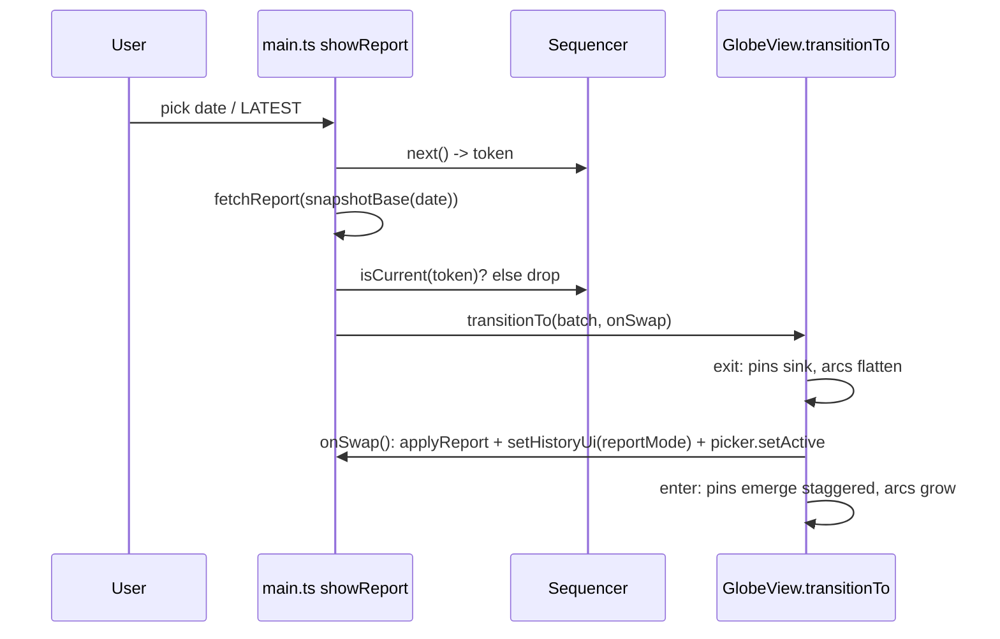

# Spec — Rebellion Timeline · Design

## Background (before this change)

**Data on disk and in S3.** The pipeline (`pipeline/stages.py` `assemble`) always writes
`snapshots/{date}/snapshot.{json,bin}`, and also `snapshots/latest/` unless the run is a
backfill. `_update_manifest` read-modify-writes `snapshots/manifest.json` as
`{"dates": [...]}`, sorted ascending, `application/json`, `max-age=300`. The state machine
invalidates `/snapshots/latest/*` and `/snapshots/manifest.json` on CloudFront.
The local CLI (`pipeline/cli.py` `_update_local_manifest`) adds `--date` to the
`manifest.json` in the parent of `--out`.

**Frontend (`frontend/src/main.ts`).**
- `loadManifest()` returned `dates.sort().reverse()`.
- `wireReportPicker` kept `activeDate` (`null` = latest) and hid LATEST when the selected
  date was `null` or `dates[0]`. `setActive` was never called on the initial load.
- `loadReport()` mixed fetching, state updates and UI side effects, and called
  `wireEffectToggles` on every load, which stacked one more heatmap click listener per load.
- The picker callback awaited `loadReport` with no request sequencing.
- `spreadBatch()` returns new point and arc objects on every load.
- Strike ids are renumbered `1..N` by every pipeline run, so any state keyed by id must
  change exactly when the markers are swapped.

**CSS.** `.btn-latest { all: unset; display: inline-flex }` beats the user-agent
`[hidden] { display: none }`, so the LATEST button was always visible.

**three-globe (`frontend/node_modules/three-globe/dist/three-globe.mjs`).**
- Data binding is keyed by object identity, so every load re-creates every pin and arc.
- The custom layer (pins) has no transitions. Pin objects are created on the next digest
  after `customLayerData(...)`, not synchronously.
- Arcs tween any accessor change on existing arcs over `arcsTransitionDuration` (Quadratic
  InOut). New arcs start from `altAutoScale: -1e-3` and grow in. Removed arcs vanish.
- A pin (`buildPin`) is a group whose shaft starts at y = 0 on the surface, so scaling the
  group toward 0 sinks it into the ground.

## Modules

### `frontend/src/history.ts` (pure, no DOM)

- `parseManifest(raw: unknown): string[]` keeps valid `YYYY-MM-DD` strings that are real
  calendar dates, dedupes, and sorts newest first. Missing or invalid `dates` → `[]`.
- `reportMode(loadedDate, latestDate): "latest" | "archive"` → `"latest"` only when
  `latestDate !== null && loadedDate === latestDate`.
- `snapshotBase(date | null)` → `/snapshots/latest` or `/snapshots/{date}`.
- `createSequencer()` → `{ next(): number; isCurrent(token): boolean }`. Each `next()`
  invalidates every older token.

### `frontend/src/transition.ts` (pure math + tween runner)

| Constant         | Value  | Use                                       |
| ---------------- | ------ | ----------------------------------------- |
| `EXIT_MS`        | 450 ms | pins sink, arcs flatten                   |
| `ENTER_PIN_MS`   | 450 ms | one pin emerging                          |
| `MAX_STAGGER_MS` | 300 ms | delay of the last pin to emerge           |
| `ENTER_ARC_MS`   | 900 ms | new arcs grow from the ground             |

- `easeInCubic` (exit) and `easeOutBack` (enter, c1 = 1.7, peak ≈ 1.0998). The textbook
  c1 = 1.70158 peaks at 1.100004, just over the 10% overshoot bound the tests enforce.
- `exitScale(elapsed, from = 1)` eases from `from` to 0 over `EXIT_MS`, clamped at 0.
- `staggerDelay(index, count)` is 0 for `count <= 1`, otherwise
  `index / (count - 1) × MAX_STAGGER_MS`.
- `enterScale(elapsed, delay)` is 0 before `delay`, then eases to exactly 1 at
  `delay + ENTER_PIN_MS`.
- `enterOrder(points)` → `Map<id, index>`, severity descending, then id ascending, so
  Dominion strikes emerge first.
- `runTween(durationMs, onFrame, clock?)` → `{ done: Promise<boolean>; cancel() }`. It
  resolves `true` after the last frame (`onFrame(durationMs)`), and `cancel()` resolves
  `false` and stops frames. `FrameClock` defaults to `performance.now` and
  `requestAnimationFrame`; tests inject a fake clock.

### `GlobeView.transitionTo(batch, onSwap): Promise<boolean>` (`frontend/src/globe.ts`)

1. **Start.** Cancel any running transition (its promise resolves `false` and its `onSwap`
   never runs). Set `transitioning`, emit `onPointHover(null)` and ignore pin hover and
   click until the end.
2. **Reduced motion.** `onSwap()`, then an instant `render(batch)`; `arcsTransitionDuration`
   is 0 from the constructor on. Resolve `true`.
3. **Exit** (skipped when nothing is on the globe, e.g. the initial load). Capture each
   current pin's scale (an interrupted transition continues from where it was) and tween
   it with `exitScale`. Arcs: `arcsTransitionDuration(EXIT_MS)` and
   `arcAltitudeAutoScale(-1e-3)` flatten the existing arcs.
4. **Swap.** `onSwap()` (app state + UI), clear `pinGroups`, set `enterPlan`, then in the
   same tick restore `arcAltitudeAutoScale(ARC_AUTO_SCALE)`, set
   `arcsTransitionDuration(ENTER_ARC_MS)` and assign the new pins and arcs. Pins created
   while `enterPlan` is set start at scale 0.
5. **Enter.** Each frame looks pins up by id in `pinGroups` (they appear asynchronously)
   and applies `enterScale(elapsed, staggerDelay(order, count))`. At the end every pin is
   set to scale 1, `enterPlan` is cleared and the promise resolves `true`.

### `frontend/src/main.ts`

- `fetchReport(base)` → `LoadedReport { batch (spread), dossiers, buffer }`, no UI effects.
- `applyReport(report)` updates `state`, the selectable countries, the banner, the country
  chips, the threat HUD and pulse rings (WASM only), and resets the heatmap (state, layer
  and the button's active class). It does not touch the globe markers or the panels.
- `showReport(date | null)` → `"shown" | "stale" | "failed" | "noop"`:

- Picking the date already shown (or LATEST while on latest) with nothing pending is a
  no-op. On the first load of `latest/`, `latestDate = batch.date`. The panels close when
  a change starts and again at the swap (a panel opened mid-transition belongs to the old
  report). The loader fades at the first swap, so the initial pins emerge as it fades.
- `setHistoryUi(mode, date, previousMode)` shows `#banner-archive` and `#btn-latest` only
  in archive mode and writes the announcement into `#report-status`. The picker's
  `setActive` only tracks and highlights the shown date (`aria-current`).
- `wireEffectToggles` runs once and reads `state.snapshotBuffer` at click time.

### UI and copy

- `index.html`: `` is the first
  child of `.banner__date-group`, so it hides with the date group when the detail panel
  opens. `` is a direct child of
  the banner and is never hidden. A live region toggled with `hidden` is not reliably
  announced, which is why the announcement does not live on the chip itself. It is
  absolutely positioned, so the latest-mode banner layout does not change.
- `styles.css`: `.banner__archive` (mono, uppercase, gold text and border on a translucent
  background, short fade-in disabled under reduced motion), `.sr-only`, and scoped
  `.btn-latest[hidden], .banner__archive[hidden] { display: none }`. No global `[hidden]`
  rule, so other elements keep their current behavior.
- `theme.ts`: `COPY.archiveBadge(label)` → `ARCHIVE · {label}`, `COPY.archiveTitle`,
  `COPY.archiveStatus(label)` and `COPY.latestStatus`.

### `frontend/scripts/sync-snapshots.sh`

- Bucket: `SNAPSHOT_BUCKET`, else the `SnapshotBucketName` output of stack `STACK_NAME`,
  else the `stack_name` in `infra/samconfig.toml`, else `infra-kiro-hackathon`.
- **Sync (default).** `aws sts get-caller-identity`, then `aws s3 sync` of
  `20??-??-??/snapshot.{json,bin}` only (never `latest/` or `manifest.json`, no `--delete`),
  then validate and write the manifest.
- **Validation.** Each `YYYY-MM-DD/` entry must be a real directory with both files; the
  `.bin` header (read with `od`) must have magic `RBMN`, version 2,
  `size == 16 + 28 × count`, and `date_days` equal to the folder name.
- **Manifest.** Valid dates, ascending, `{"dates": [...]}` plus a newline. Invalid folders
  are reported, left out, and make the script exit non-zero. (Since `../timeline-index/`,
  `scripts/manifest.mjs` writes it and also copies the `runs` of the valid folders.)
- **`--manifest-only`.** Validation and manifest only, no AWS (used by the regen hooks,
  because the CLI adds `--date` to the manifest).
- **`--publish-manifest [--dry-run] [--yes]`** (removed by `../timeline-index/`, which
  replaced it with `python -m pipeline.timeline_admin rebuild-manifest`). Target dates =
  dated S3 prefixes with both
  objects that also passed local validation. Abort if the target drops a date of the
  current S3 manifest. Print the diff (stop on `--dry-run`), refuse while the state machine
  has a RUNNING execution, ask `[y/N]` unless `--yes`, upload with `application/json` and
  `max-age=300`, and invalidate `/snapshots/manifest.json` on the distribution whose domain
  is the `CdnDomain` output.

## Tests (`frontend/tests/`, vitest, node environment)

- `history.test.ts`: `parseManifest`, `reportMode`, `snapshotBase`, `createSequencer`.
- `transition.test.ts`: easing endpoints, `exitScale`, `enterScale`, `staggerDelay`,
  `enterOrder`, `runTween` with a fake clock (completion and cancel).
- `archive.test.ts`: every manifest date has a real folder whose `.bin` decodes (TS
  decoder) to that date, the JSON `date` and strike ids match the `.bin`, every date-named
  entry is listed, and `latest/` decodes.

The tests live outside `tsconfig.json`'s `include`, so `tsc` in `npm run build` ignores them.
The WebGL behavior is checked in a browser (see `tasks.md`, Task 5). During development it
was verified with a throwaway headless Chromium script (outside the repo) that read the pin
scales, arc auto-scale and banner state frame by frame.

## Risks and notes

- **Local `latest/` can lag behind the archive.** Running a regen hook resets `latest/` to
  the pinned 2026-11-14 fixture; newer archive dates then show as ARCHIVE. That follows the
  definition of latest (story 1, AC5).
- **Manifest race in production (resolved by `../timeline-index/`).** The production
  manifest used to be read-modify-written by Assemble, so overlapping executions could
  drop a date. Assemble now derives it from the DynamoDB timeline (sparse GSI
  `runs-by-date`) and never drops a listed date, so a stale manifest heals on the next
  run.
- **Committed copies are never uploaded.** The README deploy step excludes `snapshots/*`.
