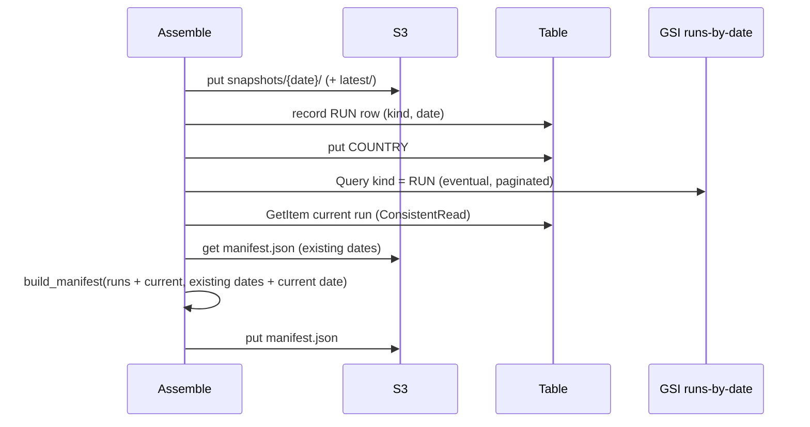

# Spec — Timeline Index · Design

## Table (`infra/template.yaml` `TimelineTable`)

Single table, `PAY_PER_REQUEST`, keys `pk` / `sk`, one GSI.

| Entity      | pk                 | sk               | kind  | date         | other attributes                                  |
| ----------- | ------------------ | ---------------- | ----- | ------------ | ------------------------------------------------- |
| Run         | `TIMELINE#YYYY-MM` | `RUN#YYYY-MM-DD` | `RUN` | `YYYY-MM-DD` | `status`, `total`, `by_severity`, counters, `generated_at` (`reconstructed` if migrated) |
| Country     | `COUNTRY#XX`       | `RUN#YYYY-MM-DD` | —     | —            | `strikes`, `by_severity`                           |
| Latest      | `LATEST`           | `RUN`            | —     | `YYYY-MM-DD` | `total`                                            |

GSI `runs-by-date`: partition `kind`, sort `date`, projection `INCLUDE [status, total]`.
DynamoDB indexes an item only when it has both key attributes, so the index holds run
rows only (the `LATEST` row has `date` but no `kind`). `AttributeDefinitions` list exactly
the key attributes (`pk`, `sk`, `kind`, `date`); CloudFormation rejects unused ones.
`date` and `status` are reserved words, so every expression uses placeholders.

## Assemble (`pipeline/stages.py`)

- Constants: `RUN_KIND = "RUN"`, `RUNS_INDEX = "runs-by-date"` (a test checks it matches
  the template), `RUN_STATUSES = ("published", "rejected")`.
- `Timeline` protocol: `record`, `put`, `list_runs() -> [{date, status, total}]`,
  `get_run(date) -> {date, status, total} | None`.
- `_run_summary(item)` validates a row (real calendar date, known status, non-negative
  integer total), converts `Decimal` to `int`, and falls back to the `RUN#` sort key for
  rows that predate `date`. `_run_summaries` logs and skips malformed rows.
- `DynamoTimeline.list_runs()`: `query(IndexName=RUNS_INDEX, KeyConditionExpression="#k =
  :run")`, paginated with `ExclusiveStartKey`. `get_run()`: `get_item(ConsistentRead=True)`.
- `InMemoryTimeline(index_lag=False)`: same semantics; `index_lag=True` hides the row of
  the latest `record()` from `list_runs()` to exercise the overlay.
- `build_manifest(runs, existing_dates) -> (manifest, kept)`: last entry per date wins,
  `dates = runs ∪ existing`, both ascending; `kept` = dates without a run.
- `_publish_manifest(storage, timeline, report_date)`: reads, overlays, always includes the
  current date, logs kept dates, writes `application/json` with `max-age=300`. A read
  failure falls back to `_update_manifest`, which now keeps keys other than `dates`.
- Without a timeline, `assemble()` still calls `_update_manifest`.

Known edge: a rejected **backfill** rerun over a published day rewrites
`snapshots/{date}/` without its strikes (no previous report) but keeps the published row,
so the manifest total no longer matches that snapshot. `archive.test.ts` would flag it
after a sync. Same-day non-backfill reruns carry the same strikes, so their totals match.

## IAM

Assemble: `DynamoDBWritePolicy` (unchanged), plus `dynamodb:Query` on
`${TimelineTable.Arn}/index/runs-by-date` and `dynamodb:GetItem` on `TimelineTable.Arn`.

## Operator CLI (`pipeline/timeline_admin.py`)

`python -m pipeline.timeline_admin [--stack S] [--region R] [--table T] [--bucket B]
{migrate,rebuild-manifest} [--apply [--yes]]`. Names come from the stack outputs; the
stack is `--stack`, else `$STACK_NAME`, else the `stack_name` in `infra/samconfig.toml`
(the stack `sam deploy` targets), else `infra-kiro-hackathon`. An unknown stack exits
with a one-line error instead of a traceback. Clients
are created lazily by `Aws(region, overrides)`; tests pass stubs through `overrides`.

- `migrate`: a filtered, paginated `Scan` (admin only) for `TIMELINE#`/`RUN#` rows,
  re-filtered on the client; `published_dates` = dated S3 prefixes with both artifacts.
  `plan_migration(rows, dates, read_report)` returns `update` actions (`SET #k = :run,
  #d = :date`, `attribute_exists(pk)`) and `reconstruct` actions (`put_item`,
  `attribute_not_exists(pk)`, totals and `generated_at` from `snapshot.json`, whose date
  must match its folder).
- `rebuild-manifest`: `list_runs()` + `build_manifest()` with the current S3 manifest
  dates. Refuses to drop a date, to list a date without both artifacts, and to write while
  an execution is RUNNING. Resolves the distribution by the `CdnDomain` output before
  writing, then writes and invalidates `/snapshots/manifest.json`.

Exit codes: 0 done or nothing to do, 1 refused or aborted, 2 usage.

## Frontend

- `history.ts`: `RunInfo { status, total }`, `parseRuns(raw) -> Map<date, RunInfo>`
  (ignores invalid entries; a later one wins), `pickerEntry(run) -> { meta, rejected }`.
  `parseManifest` is unchanged. `history.ts` imports `COPY` from `theme.ts`, which has no
  DOM access, so the module stays testable in Node.
- `main.ts`: `loadManifest() -> { dates, runs }`; `picker.setDates(dates, runs)`. Each
  `button.picker__date` holds `.picker__label` and, when the run is known,
  `.picker__details` with an optional `.picker__tag--rejected` and `.picker__meta`. Text
  nodes with a space separate the spans so the accessible name reads
  `Mon, Nov 16, 2026 REJECTED 27 strikes`.
- `theme.ts` `COPY`: `pickerStrikes(n)`, `pickerRejected`, `pickerRejectedTitle`.
- `styles.css`: `.picker__date` is a flex row (label left, details right); `.picker__meta`
  is small and muted; `.picker__tag--rejected` reuses the archive chip's red.

## Archive tooling

- `frontend/scripts/manifest.mjs`: `buildArchiveManifest(validDates, source)` keeps the
  valid `runs` of valid folders (sorted, last wins) and omits `runs` when the source has
  none; `formatManifest` reproduces Python's `json.dumps` separators plus a newline, so the
  CLI, Assemble and the script do not reformat each other's output. A small CLI
  (`--out`, `--source`, dates) is called by the shell script.
- `sync-snapshots.sh`: sync mode copies the production manifest to a temp file (read-only)
  as the source, with the local manifest as `--fallback`, so a folder that production no
  longer lists (a stack rebuilt from scratch) keeps its local run; if the production
  manifest cannot be read, the local one is the source. `--manifest-only` uses the local
  manifest. Requires node. `--publish-manifest` exits 2 with a pointer to
  `rebuild-manifest`.
- `pipeline/cli.py` `_update_local_manifest` keeps keys other than `dates`.

## Rollout (production, 2026-11-23)

1. **Deploy 1 (index only).** Built from the deployed template with only `TimelineTable`
   changed (a SAM build would also have touched the Lambdas, whose code had drifted from
   the last deploy). Changeset: `TimelineTable` Modify. The index backfilled to ACTIVE in
   about 8 minutes, empty.
2. **Deploy 2 (code + IAM)** via `sam deploy --no-execute-changeset`: the four functions
   (code), `AssembleFunctionRole` (policies), and `RebellionStateMachine` (dynamic
   re-evaluation of the function ARNs only). `TimelineTable` was not modified.
3. **Migration:** 4 updates + 1 reconstruction (2026-11-15, 33 strikes).
4. **Manifest rebuild:** no date added or dropped; 5 runs written; invalidation
   `I1YITCWHLGQ70GARBQAZDJ17LL` on `ELSZBF42YYFZN`.
5. **Archive sync:** only `manifest.json` changed locally.
6. **Deploy 3 (drop `sk-pk-index`)**, again from the deployed template. The changeset
   listed the Assemble role, function and state machine as Dynamic re-evaluations caused
   by `TimelineTable.Arn`; only `TimelineTable` was updated, and the role policies, the
   function and the state machine definition were byte-identical before and after.

The deployed Lambda package predates two changes that Lambda never runs:
`pipeline/cli.py` (keeps `runs`) and the new `pipeline/timeline_admin.py`. The next
regular deploy picks them up.
