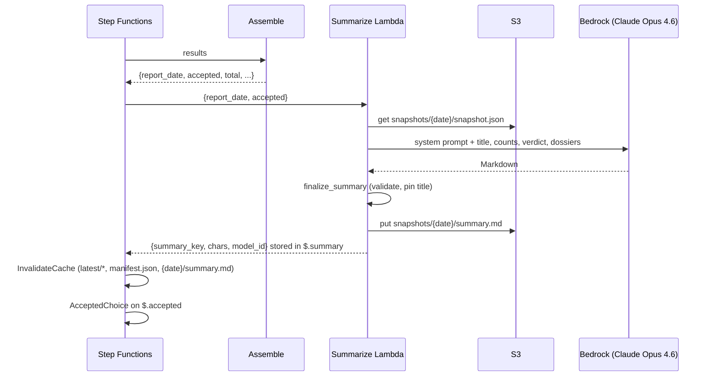

# Spec — Weekly Summary · Design

## Flow

## `pipeline/summarize.py`

- Constants: `DEFAULT_SUMMARY_MODEL_ID = "global.anthropic.claude-opus-4-6-v1"` (the
  global cross-region inference profile, active in the account), `SUMMARY_FILENAME`,
  `SUMMARY_CONTENT_TYPE = "text/markdown; charset=utf-8"`, `SUMMARY_MAX_TOKENS = 8192`,
  `MAX_SUMMARY_CHARS = 40_000`.
- `window_label(report_date)` → `Nov 16-23, 2026` (`Oct 28-Nov 4, 2026` across months,
  `Dec 28, 2026-Jan 4, 2027` across years), from `transform.RECENCY_WINDOW_DAYS`. It
  matches the titles of the hand-written summaries; `archive.test.ts` reimplements it in
  TypeScript to check every committed summary.
- `SYSTEM_PROMPT`: factual-only rules and the section structure of the existing
  summaries.
- `build_prompt(report, accepted)`: title, window, counts per tier, batch verdict, then
  one JSON object per strike with `title, witness, published, location, country,
  attack_type, severity, summary, data_affected, impact, prevention` (no URLs or
  coordinates).
- `finalize_summary(text, report_date)`: strips a surrounding code fence, requires a `# `
  title and a non-empty body, caps the length, replaces the first line with the computed
  title, ends with one newline. Raises `SummaryError`.
- `empty_summary(report_date)` and `generate_summary(report, summarizer, accepted)`.
- `StrandsSummarizer(model_id, region, agent_factory)`: builds `Agent(model=
  BedrockModel(model_id, max_tokens, region_name), system_prompt, callback_handler=None)`
  lazily; `__call__` raises `SummaryError` unless `stop_reason == "end_turn"`.

## `pipeline/stages.py` `summarize(event, *, storage, summarizer)`

Requires `report_date` (ISO date, so the key cannot escape `snapshots/{date}/`), reads
that date's `snapshot.json` and checks its date, loads the bearer token only when it
builds the real summarizer, calls `generate_summary` (passing `accepted`), and writes
`snapshots/{date}/summary.md` with `max-age=300`. Errors propagate for the state's Retry
and Catch. `handler.py` re-exports it.

## State machine (`infra/statemachine/rebellion.asl.json`)

- `Assemble.Next = Summarize`; `Summarize`: `lambda:invoke` with `{report_date, accepted}`,
  `ResultSelector {key, model_id}`, `ResultPath $.summary` (so `$.accepted` survives),
  `Retry` on `States.ALL` (2 × 10 s, backoff 2), `Catch` → `ResultPath $.summary_error`,
  `Next InvalidateCache`.
- `InvalidateCache` paths: `Quantity 3`, `Items.$` = `States.Array('/snapshots/latest/*',
  '/snapshots/manifest.json', States.Format('/snapshots/{}/summary.md', $.report_date))`.
  Validated with `stepfunctions:ValidateStateMachineDefinition` (result `OK`).

## Template (`infra/template.yaml`)

- Parameter `SummaryModelId` (default Opus 4.6). `AgentRegion` is shared.
- `SummarizeFunction`: `CodeUri .build/lambda`, `Timeout 300`, env `SNAPSHOT_BUCKET`,
  `SUMMARY_MODEL_ID`, `AGENT_REGION`, `BEDROCK_TOKEN_SECRET_ARN`; policies
  `s3:GetObject` on `snapshots/*/snapshot.json`, `s3:PutObject` on
  `snapshots/*/summary.md`, Bedrock invoke on foundation models and inference profiles,
  `secretsmanager:GetSecretValue` on the secret.
- State machine: `SummarizeFunctionArn` substitution and a `LambdaInvokePolicy`.
- Preflight still checks only the extraction model: an unavailable summary model must
  not stop the report, it only loses the summary.

## Frontend and archive

- `main.ts`: `summary.update(snapshotBase(report.batch.date))`, so the summary always
  comes from the dated folder of the report on screen.
- `frontend/public/snapshots/latest/summary.md` is deleted; `archive.test.ts` checks it
  stays absent and that each dated summary's title names its own window.
- `sync-snapshots.sh` also includes `20??-??-??/summary.md`.

## Rollout (done by the developer)

1. `sh infra/build-lambda.sh && cd infra && sam build && sam deploy`. The changeset adds
   `SummarizeFunction` and its role, and modifies `RebellionStateMachine` and its role.
2. Redeploy the frontend (`npm run wasm && npm run build`, `aws s3 sync frontend/dist
   s3://<bucket>/ --exclude 'snapshots/*'`, invalidate `/index.html`).
3. `aws s3 rm s3://<bucket>/snapshots/latest/summary.md`.
4. Optional: invoke the Lambda once with `{"report_date": "2026-11-23"}` to summarize the
   current report (one Opus call), then invalidate `/snapshots/2026-11-23/summary.md`.
